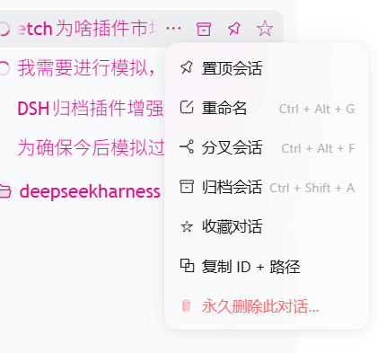
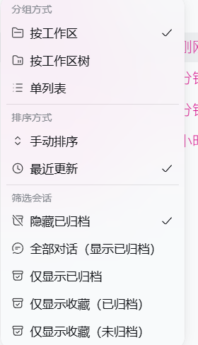
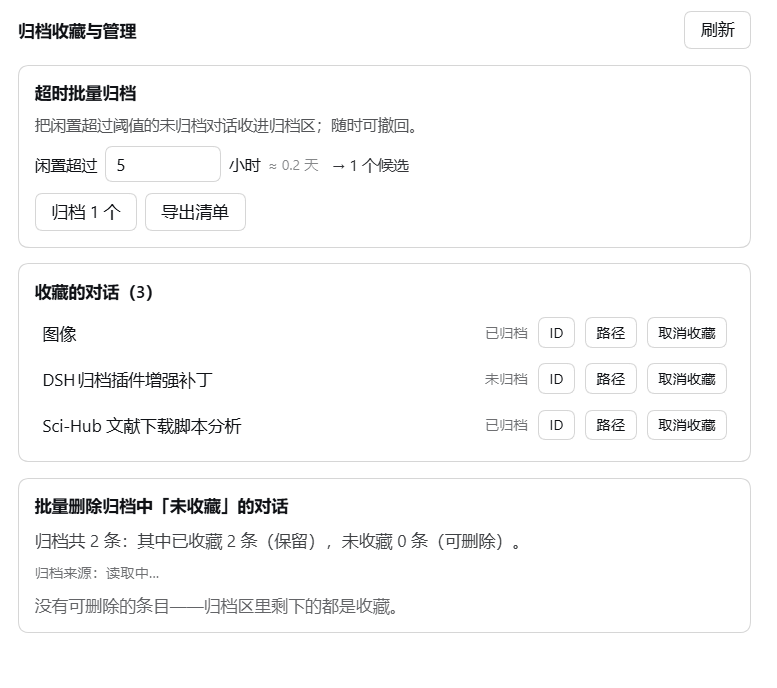

# dsh-archive-favorites-forge

**Favourites, copy id+path, per-session delete, idle batch archive and a
favourites filter for DeepSeek Harness conversations** — additive slot
extensions over the shipped archive feature. It edits **no official file**.

**给 DSH 的对话加上收藏、复制 ID+路径、单条删除、超时批量归档和收藏筛选 —— 全部挂在官方插槽上，不改官方一行代码。**

[](https://www.npmjs.com/package/dsh-archive-favorites-forge)
[](LICENSE)
[](https://github.com/loyalchiiina/dsh-archive-favorites-forge)

English | [简体中文](README.zh.md)

---

## Screenshots

**1. The conversation menu** — favourite, copy id + path, and a guarded permanent delete, added as three rows to the shipped 「…」 menu:



**2. The favourites filter** — two extra rows in the official 筛选会话 group, narrowing the sidebar to favourites that are archived and to favourites that are not:



**3. The settings panel** — idle batch archive, the favourites list with archive state, and batch delete of archived conversations that are not favourites:



---

## Why this exists

DSH already ships an archive feature: the Workspace registry keeps a global
`archivedSessionIds` set and `@deepseek-ai/dsh-client-ui-workspace` renders the
sidebar rows plus a view-options filter. That shipped feature has **no
favourites, no per-conversation delete, no copy-id/path affordance, and no
time-based batch archive** — and it deliberately refuses to open an archived
conversation.

This plugin adds those things by attaching to documented official slot points,
so it composes with the shipped UI instead of patching it.

## Features · At a glance

| | 中文 | English |
|---|---|---|
| ① | **收藏对话**：归档或未归档的对话都能收藏；「…」菜单项 + 行内 ☆，星标即时生效 | **Favourite any conversation** — archived or not; a menu row plus an inline ☆ star, applied optimistically |
| ② | **复制 ID + 路径**：「…」菜单一键复制会话 ID 与转录文件绝对路径（两行） | **Copy id + path** — one menu row copying the session id and the transcript's absolute path |
| ③ | **单条永久删除**：任意非收藏对话可删，二次确认；删完侧栏**立即移除该行** | **Per-conversation permanent delete** — any non-favourite, behind a confirmation, and the sidebar row disappears at once |
| ④ | **超时批量归档**：把闲置超过 N 小时的未归档对话一次性归档，可撤回 | **Idle batch archive** — archives conversations quiet for more than N hours, undoable |
| ⑤ | **导出清单**：制表符分隔的 txt，含**对话名称 / 对话ID / 所属工作区 / 闲置时长 / 最后活动时间**；可复制路径或直接打开所在文件夹 | **Export list** — a tab-separated txt with name, id, workspace, idle time and last-activity time; copy its path or reveal it in the file manager |
| ⑥ | **收藏筛选**：视图选项菜单新增「仅显示收藏（已归档）」与「仅显示收藏（未归档）」 | **Favourites filter** — view-options rows for favourites that are archived, and favourites that are not |
| ⑦ | **批量删除**：一键永久删除「已归档且未收藏」的对话 | **Batch delete** — permanently removes the archived-and-unfavourited conversations |
| ⑧ | **删除护栏**：收藏项拒删、越出会话根目录拒删、符号链接拒删、逐条报告、批量上限 | **Delete guardrails** — favourites refused, paths outside the sessions root refused, symlinks refused, per-id reporting, batch cap |

### Where each feature lives

| Feature | UI location |
|---|---|
| Favourite / copy / delete one conversation | Sidebar row 「…」 menu (and a hover ☆ on the row) |
| Idle batch archive, export list, favourites list, batch delete | **Settings → 归档收藏** |
| Favourites filter | **视图选项 → 筛选会话** |

## Install

```powershell
dsh plugin --profile <profile> add dsh-archive-favorites-forge
```

Then **fully quit and reopen DSH**. The host half (`lib/index.js`) has no
watcher in this harness generation, and the client bundle is snapshotted at
startup — so a page refresh alone does **not** pick up a new version.

## How it works

```
lib/index.js    host half   — favourites store, transcript-path resolver,
                              JSON routes, guarded delete, archive/dearchive
lib/client.js   client half — official slot registrations + one DOM rule
```

**Slots used** (all documented in the harness client contract):

| Slot | What it contributes |
|---|---|
| `sidebar.workspaces.session.menu.item` | 3 rows: favourite, copy id+path, delete |
| `sidebar.workspaces.session.row.action` | 1 hover ☆ star |
| `settings.section` | the 归档收藏 page |

Every contribution is registered through `ctx.slots.inject` — the "register once
the owning entry is mounted" contract — so the plugin never assumes the sidebar
is up, and never holds a reference to a node the host owns.

The favourites filter is the one exception: the view-options menu is a plain
array with **no slot and no trigger id**, so that single control is added by
finding the official filter row in the DOM and cloning it. It keys on
`role`/`aria`/`data-row-key` attributes, never on the CSS-module hashes (which
are re-hashed on every build).

### Why the favourites set lives in a file, not `localStorage`

Renderer `localStorage` is origin-scoped: the desktop shell, a phone view and a
remote browser are different origins and would each keep their own stars. The
host half persists them to

```
~/.dsh/data/dsh-archive-favorites-forge/favorites.json
```

which survives a profile switch, a reinstall, and both ends.

### Why the delete is host-side and guarded

There is **no official session-delete RPC** in this harness generation — the
shipped UI never deletes a session. "Delete this conversation" therefore means
removing the session's own artifact directory under `~/.dsh/sessions/`. That is
irreversible, so the host applies these guards before it removes anything:

1. a **favourited** id is refused outright (checked host-side, not just in the UI);
2. a resolved path **outside the sessions root** is refused;
3. a **symlink** is refused;
4. the sessions root itself is refused;
5. the batch is capped by `maxDeletePerCall`.

Each id is reported separately, so one failure never aborts the batch. After a
successful delete the host emits `api-session/removed` — the harness's own
row-removal event — so the sidebar drops the row immediately instead of showing
it until the next reload.

## Configuration

| Key | Default | Meaning |
|---|---|---|
| `enabled` | `true` | Master switch for the host routes |
| `maxDeletePerCall` | `500` | Hard cap on one delete request |

```yaml
- id: dsh-archive-favorites-forge
  config:
    maxDeletePerCall: 200
```

## Notes and limits

- **The id form**: session ids are spelled `session-<uuid>`, but artifact
  directories on an upgraded machine use **both** `<uuid>` and `session-<uuid>`.
  Every comparison goes through a normaliser and the resolver tries both
  spellings, so this works for old and new conversations alike.
- **Archived conversations cannot be opened** — that is shipped DSH behaviour,
  not this plugin's. Unarchive first if you want to read one.
- **Deleting is permanent.** It removes the conversation and its transcript. It
  does not touch your project working directory.
- **Blank sessions are never candidates.** A "blank" session is the provisional
  New Session slot; it has no content to archive and the shipped sidebar hides
  every blank session except the currently selected one, so a candidate list
  containing one would be impossible to verify. They are excluded from both the
  idle pool and the batch-delete set, and the export names the rest the way the
  sidebar does (`新会话` / `未命名`).
- **Candidate lists are intersected with what the sidebar actually lists.** A
  session that is archived but not rendered (no `cwd`) is never counted or
  acted on.
- The plugin reads the Workspace registry to map a session to its owning
  folder. It mutates that registry only through the registry's **own**
  `archiveSession` / `unarchiveSession` methods, and never writes another
  plugin's internals.

## Development

```
lib/index.js             host half
lib/client.js            client half (a __ModuleLoader__ bundle)
test/probe-client.mjs    DOM-stub + host probe suite
```

Run the suite:

```sh
node test/probe-client.mjs
```

The probe is not a formality — it has repeatedly caught bugs that a syntax
check and a careful read both passed, including:

- a project-directory encoder producing `C--Users` instead of `C-Users`, which
  would have handed every "copy path" a nonexistent file;
- a resolver that only tried the bare-uuid directory form, silently failing for
  the sessions using the `session-` prefix;
- a hiding rule that was **not** gated on the favourites set having loaded, so
  it could empty the entire sidebar;
- an archive-load failure that silently disabled the whole favourites filter,
  because two independent gates shared one flag.

It asserts against the **real** directories and the **real** registry on the
machine, plus DOM fixtures that mirror the official markup exactly (including
the selection tick being a bare `<svg>` on the selected row only) — which is
what exposed each of those.

## License

MIT.
