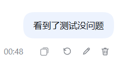

# dsh-archive-favorites-forge

**Favourites, copy id+path, per-session delete, idle batch archive, a favourites
filter, and edit-resend / undo-turn with automatic file rollback for DeepSeek
Harness conversations** — additive slot extensions over the shipped archive
feature. It edits **no official file**.

**给 DSH 的对话加上收藏、复制 ID+路径、单条删除、超时批量归档、收藏筛选，以及「编辑重发 / 撤销整轮 + 文件自动快照回滚」 —— 全部挂在官方插槽上，不改官方一行代码。**

[](https://www.npmjs.com/package/dsh-archive-favorites-forge)
[](LICENSE)
[](https://github.com/loyalchiiina/dsh-archive-favorites-forge)

English | [简体中文](README.zh.md)

---

## Screenshots

**1. The conversation menu** — four rows added to the shipped 「…」 menu: favourite, copy id + path, continue in a new window, and a guarded delete. The harness's own duplicate 「复制 Session ID」 row is hidden:


**2. The favourites filter** — two extra rows in the official 筛选会话 group, narrowing the sidebar to favourites that are archived and to favourites that are not:


**3. The settings panel** — idle batch archive, the favourites list with archive state, and batch delete of archived conversations that are not favourites:


**4. The per-turn buttons** — 复制 → ↺ undo → ✏️ edit-and-resend → 🗑 delete under every human message, including the messages you interject mid-turn:



---

## Why this exists

DSH already ships an archive feature: the Workspace registry keeps a global
`archivedSessionIds` set and `@deepseek-ai/dsh-client-ui-workspace` renders the
sidebar rows plus a view-options filter. That shipped feature has **no
favourites, no per-conversation delete, no copy-id/path affordance, and no
time-based batch archive** — and it deliberately refuses to open an archived
conversation. The transcript has **no per-message edit or undo** either, and
nothing in the harness rolls back the files an assistant turn rewrote. The
sidebar's "Ungrouped" bucket has **no explanation and no repair entry point**.

This plugin adds those things by attaching to documented official slot points,
so it composes with the shipped UI instead of patching it.

## Features · At a glance

> Every feature below marked "Settings → Archive favourites" lives behind a
> **single row of function buttons** on one page: pick 超时归档 / 归档清理 /
> 快照占用 / 收藏列表 / 未分组体检 and only that panel is shown. The other
> panels are hidden, not unmounted, so a report you just measured is still
> there when you come back. The choice is remembered across restarts.

| | 中文 | English |
|---|---|---|
| ① | **收藏对话**：归档或未归档的对话都能收藏；「…」菜单项 + 行内 ☆，星标即时生效 | **Favourite any conversation** — archived or not; a menu row plus an inline ☆ star, applied optimistically |
| ② | **复制 ID + 路径**：「…」菜单一键复制会话 ID 与转录文件绝对路径（两行） | **Copy id + path** — one menu row copying the session id and the transcript's absolute path |
| ③ | **单条永久删除**：任意非收藏对话可删，二次确认；删完侧栏**立即移除该行** | **Per-conversation permanent delete** — any non-favourite, behind a confirmation, and the sidebar row disappears at once |
| ④ | **超时批量归档**：把闲置超过 N 小时的未归档对话一次性归档，可撤回；**候选直接列在卡片里**（闲置时长 + 标题 + 工作区），不必先导出清单才知道要归档什么 | **Idle batch archive** — archives conversations quiet for more than N hours, undoable; the candidates are **listed right in the card** (idle time, title, workspace), so you never have to export a list just to see what would be archived |
| ⑤ | **导出清单**：制表符分隔的 txt，含**对话名称 / 对话ID / 所属工作区 / 闲置时长 / 最后活动时间**；可复制路径或直接打开所在文件夹 | **Export list** — a tab-separated txt with name, id, workspace, idle time and last-activity time; copy its path or reveal it in the file manager |
| ⑥ | **收藏筛选**：视图选项菜单新增「仅显示收藏（已归档）」与「仅显示收藏（未归档）」 | **Favourites filter** — view-options rows for favourites that are archived, and favourites that are not |
| ⑦ | **批量删除**：一键永久删除「已归档且未收藏」的对话 | **Batch delete** — permanently removes the archived-and-unfavourited conversations |
| ⑧ | **删除护栏**：收藏项拒删、越出会话根目录拒删、符号链接拒删、逐条报告、批量上限 | **Delete guardrails** — favourites refused, paths outside the sessions root refused, symlinks refused, per-id reporting, batch cap |
| ⑨ | **编辑重发**：任意一条用户消息下多一个 ✏️，点开就是内联编辑框（可拖入文件 / 粘贴图片，最多 10 个附件、单个 8MB），发送即截断到该消息之前并重发 | **Edit and resend** — a ✏️ under any user message opens an inline editor (drag files or paste images, 10 attachments max, 8 MB each); sending truncates the conversation to just before that message and resends |
| ⑩ | **撤销整轮**：↺ 把对话回退到该轮之前，并**默认同时还原这一轮里被 AI 改过的文件**（确认框里列出将被回滚的路径，可取消勾选只回退对话） | **Undo a turn** — ↺ rewinds the conversation to before that turn and, by default, also **restores the files the assistant changed during it** (the confirm dialog lists the affected paths; untick to rewind the conversation only) |
| ⑪ | **文件快照**：AI 每次改文件（`write` / `edit` / `str_replace_editor`）前自动留一份内容快照，撤销时按最早的改动记录还原；没有快照的老会话从日志反推 | **File snapshots** — every `write` / `edit` / `str_replace_editor` call snapshots the file's prior bytes first; undo restores from the earliest change after the boundary, and falls back to reconstructing from the transcript log for conversations that predate the plugin |
| ⑫ | **未分组体检**：只读诊断侧栏「未分组」里到底有哪几条会话、每条为什么在那儿、该怎么处置；**先试算再执行**，删的一律进回收站 | **Ungrouped health check** — a read-only diagnosis of exactly which conversations sit in the sidebar's "Ungrouped" bucket, why each one is there, and what to do with it; a dry run comes first and deletes go to the recycle bin |
| ⑬ | **未分组硬门**：插件每次启动 8 秒后自检一次，有游离会话就在日志里告警并指路体检卡片；干净则记一行 `clean` | **Ungrouped boot gate** — 8 seconds after every start the plugin re-checks; a non-empty bucket logs a warning naming the first ten ids, a clean one logs a single `clean` line |
| ⑭ | **缓存幽灵清理**：清掉「会话目录已不在、但投影缓存还留着」的孤儿记录——这是「未分组」清完又冒出来的真正原因，目录扫描看不见它 | **Ghost-cache sweep** — removes orphan projection records whose session directory is long gone; this is why the bucket keeps reappearing and no directory scan can see it |
| ⑮ | **隐藏「未分组」分组**：一个纯视图开关（**默认开启**），把侧栏底部那个分组（连组头）整体藏起来，不删任何对话 | **Hide the "Ungrouped" group** — a pure view switch (**on by default**) that hides the whole bucket (header and rows) from the sidebar; nothing is deleted |
| ⑯ | **新窗口继续对话**：把长对话蒸馏成一份交接书（用户要求时间线 + 任务进度清单 + 团队任务 + 最近进展），先弹窗报告「检测到任务进行到 第 N 轮」，确认后新开一个 `新对话-<原名>`、**继承原对话的预设智慧体**并自动把交接书发过去 | **Continue in a new window** — distils a long conversation into a handover brief (requirement timeline, task progress, team tasks, latest progress), reports "you are N turns in" first, then on confirm opens `新对话-<original title>` with the **original agent preset inherited** and sends the brief as its first message |
| ⑰ | **快照占用统计 + 手动删除**：设置页点「立即统计」才扫一次（渲染时不扫、无定时器），列出每个会话 `history-file/` 占了多少、多少个快照文件、多少条记录、**不活跃时长**；**收藏的会话不进可删列表**，只在汇总行单独报；可选打开「超时预勾选」（默认关，开前须确认风险）自动勾上超时行，删除仍需先试算再二次确认，删的目录进 Windows 回收站。**绝不自动清理** | **Snapshot usage & manual cleanup** — one press of "measure now" scans the ledger directories once (never on render, never on a timer), reporting bytes, blob count, row count, **idle time and last snapshot time** per conversation; **favourited conversations are lifted out of the cleanup list** and reported on a separate summary line; an optional "pre-tick idle rows" switch (off by default, risk acknowledgement required) ticks rows past the threshold after each scan; deletion still needs a dry run plus a confirm, and the directory goes to the recycle bin. **Nothing is ever pruned automatically** |

### Where each feature lives

| Feature | UI location |
|---|---|
| Favourite / copy / delete one conversation | Sidebar row 「…」 menu (and a hover ☆ on the row) |
| Idle batch archive, export list, favourites list, **batch delete of archived conversations (inlined list, per-row ticks, dry run → confirm, its own pre-tick switch)**, **ungrouped health check** | **Settings → 归档收藏** |
| Favourites filter | **视图选项 → 筛选会话** |
| Edit-resend / undo turn / delete one message | The ↺ ✏️ 🗑 buttons under each **user** message in the transcript |
| Undo and edit confirmation | A modal (`shell.overlay`) — the only place the plugin draws outside the sidebar |
| **Snapshot usage & cleanup** | **Settings → 归档收藏** (the 「快照占用」 card) |

## Install

```powershell
dsh plugin --profile <profile> add dsh-archive-favorites-forge
```

Then **fully quit and reopen DSH**. The host half (`lib/index.js`) has no
watcher in this harness generation, and the client bundle is snapshotted at
startup — so a page refresh alone does **not** pick up a new version.

## How it works

```
lib/index.js    host half   — favourites store, transcript-path resolver,
                              JSON routes, guarded delete, archive/dearchive,
                              file snapshots + transcript-log parsing
lib/client.js   client half — official slot registrations + two DOM rules
                              (the favourites filter and the transcript buttons)
```

**Slots used** (all documented in the harness client contract):

| Slot | What it contributes |
|---|---|
| `sidebar.workspaces.session.menu.item` | 4 rows: favourite, copy id+path, continue in a new window, delete |
| `sidebar.workspaces.session.row.action` | 1 hover ☆ star |
| `settings.section` | the 归档收藏 page |
| `shell.overlay` | the one confirmation modal used by edit-resend and undo |

**Host routes** (all under `/plugins/dsh-archive-favorites-forge`):

| Route | Purpose |
|---|---|
| `GET /status` | version + state paths, for diagnostics |
| `GET /favorites`, `POST /favorite` | the favourites set |
| `GET /archived`, `POST /unarchive` | the archived set, and undo of one archive |
| `GET\|POST /idle-archive` | preview and apply the idle batch archive |
| `POST /export-list` | write the tab-separated list |
| `POST /reveal` | open the file manager on a path |
| `POST /session-info` | one session's title / workspace / transcript path |
| `POST /delete` | guarded permanent delete (batch; the session-menu delete goes through it) |
| `GET\|POST /archive-delete-policy` | the idle pre-tick switch and threshold for the archive-delete list (**its own policy file**) |
| `POST /archive-delete` | batch delete of archived-but-unfavourited conversations; the host rebuilds the candidate set, **dry run unless `confirm: true`**, favourites refused |
| `POST /session-turn-info` | one turn's user text, its file-change list, and the fork boundary |
| `POST /session-files-restore` | roll back the files changed after a given sequence number |
| `POST /session-replace` | retire the original conversation after a fork took its place |
| `POST /session-digest` | read-only: distil a long conversation into a requirement-timeline + task-progress brief for a fresh window |
| `POST /ungrouped-diagnose` | read-only health check: which conversations would land in "Ungrouped", why, and what to do |
| `POST /ungrouped-cleanup` | one-click cleanup; **dry run unless `confirm: true`**, and it re-diagnoses before acting |
| `POST /ungrouped-explain` | the prose answer to "why does Ungrouped exist, and is it from deleting conversations?" |
| `GET\|POST /ghost-cache-diagnose` | read-only: orphan projection-cache records whose session directory is gone |
| `POST /ghost-cache-clean` | recycle orphan cache files; **dry run unless `confirm: true`**, re-scans first, pinned records kept by default |

Every contribution is registered through `ctx.slots.inject` — the "register once
the owning entry is mounted" contract — so the plugin never assumes the sidebar
is up, and never holds a reference to a node the host owns.

Two DOM rules exist, both deliberate exceptions:

- **The favourites filter.** The view-options menu is a plain array with **no
  slot and no trigger id**, so that single control is added by finding the
  official filter row in the DOM and cloning it.
- **The transcript buttons.** The conversation transcript has no slot for
  per-message actions either, so ↺ ✏️ 🗑 are appended after the official copy
  button under each user message. The anchor is the single `[data-clock="start"]`
  node per message, and the owner is its
  `[data-chat-flow-kind="user"][data-chat-turn]` **or**
  `[data-chat-flow-kind="steering"][data-chat-turn]` ancestor — the harness
  labels a turn-opening question `user` and a mid-turn interjection `steering`,
  and both share the same `UserMessageNodeView`, so matching `user` alone leaves
  every interjected message without buttons (fixed in 0.28.2). Never a
  CSS-module hash (those are re-hashed on every build).
  A `MutationObserver` re-runs the scan, so messages that stream in later get
  their buttons too.

### Why the favourites set lives in a file, not `localStorage`

Renderer `localStorage` is origin-scoped: the desktop shell, a phone view and a
remote browser are different origins and would each keep their own stars. The
host half persists them to

```
~/.dsh/data/dsh-archive-favorites-forge/favorites.json
```

which survives a profile switch, a reinstall, and both ends.

### Why the delete is host-side and guarded

There is **no official session-delete RPC** in this harness generation — the
shipped UI never deletes a session. "Delete this conversation" therefore means
removing the session's own artifact directory under `~/.dsh/sessions/`. That is
irreversible, so the host applies these guards before it removes anything:

1. a **favourited** id is refused outright (checked host-side, not just in the UI);
2. a resolved path **outside the sessions root** is refused;
3. a **symlink** is refused;
4. the sessions root itself is refused;
5. the batch is capped by `maxDeletePerCall`.

Each id is reported separately, so one failure never aborts the batch. After a
successful delete the host emits `api-session/removed` — the harness's own
row-removal event — so the sidebar drops the row immediately instead of showing
it until the next reload.

### Why edit and undo are "fork, then retire the original"

There is no in-place "truncate this conversation" RPC either. The only official
way to keep a prefix of a conversation is `sessions.fork({ sessionId, atSeq })`,
which produces a **new** child conversation holding everything before `atSeq`.

So both buttons do the same three-step dance:

1. **Fork** the conversation at the boundary (for the first turn there is no
   prefix to keep, so `sessions.create` opens a fresh conversation in the same
   workspace instead);
2. **Optionally roll the files back** — `POST /session-files-restore` restores
   every file the assistant touched after that boundary;
3. **Retire the original** via `POST /session-replace`, because the original is
   now superseded by its own fork and leaving it around would double every row
   in the sidebar.

Step 3 is the one place where a **favourite** conversation may be deleted, and it
is the reason `handleDelete` grew an explicit `replace` flag rather than the
client simply calling `/delete`: a favourite means "keep this conversation", and
the conversation being retired here is *the one the fork replaced*. Only the
favourite guard is skipped. Every other guard — sessions-root containment, not
the root itself, non-symlink, is-a-directory, and the EBUSY/EPERM retries — stays
on, because a fork produces an ordinary session directory and none of those
conditions have become safe. The flag is threaded as an explicit parameter on a
**separate route**, so a `/delete` request body can never switch the guard off.

`beforeSeq` (the fork boundary) is the sequence number of the event **immediately
before** the turn's `turn/start`, not the `turn/start` itself. Forking inside the
gap between `turn/start` and the first user message would leave an unclosed
`turn/start` in the child, and the fork synthesises a completed-turn line to
close it — a phantom empty turn.

### Why the file snapshots are content-addressed

Before each `write` / `edit` / `str_replace_editor` call the host copies the
file's current bytes to

```
~/.dsh/sessions/<workspace-dir>/<session-dir>/history-file/blobs/<sha256>
```

and appends one line to `history-file/manifest.jsonl`:

```json
{"seq": 412, "turn": 7, "time": "...", "tool": "edit", "path": "C:\\...", "blob": "<sha256>"}
```

`blob: null` means the file did not exist at that moment, so restoring it means
**deleting** it. Hashing the content means a file edited five times in one turn
is stored once, and rolling back consumes the manifest entries it used (and the
blobs they orphaned), so a rolled-back conversation does not keep growing.

Snapshots are written **before** the tool runs, so the very first `write` to a
brand-new file records "did not exist" rather than its post-write content.

### Why there is a log-reverse fallback

Conversations that predate this plugin have no manifest. For those, the host
re-reads the transcript (`session[.vN].jsonl.zstd`, multi-frame zstd, header line
dropped) and applies the inverse of each recorded tool call in reverse order:
`edit` swaps `new_string` back to `old_string`, `str_replace_editor create`
deletes the file, `str_replace` swaps `new_str` back to `old_str`, `insert`
removes `new_str`.

`write` cannot be inverted — a full overwrite leaves no trace of what was there —
so a conversation whose only changes came from `write` gets a **warning** naming
the file instead of a silent no-op. That warning is surfaced in the confirm
dialog, which is why the file list is fetched *before* the dialog opens.

### Why "Ungrouped" is not caused by deleting conversations

The official sidebar's `sessionVisible()` runs four checks in order:

```js
if (session.origin === "subagent") return false           // 1. subagents out
if (session.blank && session.id !== current) return false  // 2. other blanks out
case "default": return !archived.has(session.id)           // 3. archived out
// 4. only now: "is this session accounted for by a workspace?"
```

Step 3 returns `false` outright, so an archived id **never reaches** the `stray`
branch that builds the bucket. The chain "delete a conversation → its id lingers
in `archivedSessionIds` → an Ungrouped group appears" therefore does not exist in
the code. Measured counter-evidence: this machine's `archivedSessionIds` holds
**98 ids whose session directories no longer exist**, and the sidebar stayed clean
throughout.

The one real cause is: **a session was created but never accounted for by any
workspace.** If `WorkspaceRegistry.create()` misses its `attachSession`, or the
session's `cwd` points at a directory that was never registered as a workspace,
it stays stray forever. A plugin cannot intercept the official create path, so
the design is "warn once per boot" + "fix it in one click" — never a silent
auto-delete.

## Configuration

| Key | Default | Meaning |
|---|---|---|
| `enabled` | `true` | Master switch for the host routes |
| `maxDeletePerCall` | `500` | Hard cap on one delete request |
| `ungroupedCheck` | `true` | Boot-time Ungrouped self-check; `false` silences the warning (the health card still works) |
| `ungroupedCheckDelayMs` | `8000` | How long after start the self-check runs, in ms |

```yaml
- id: dsh-archive-favorites-forge
  config:
    maxDeletePerCall: 200
```

## Notes and limits

- **The id form**: session ids are spelled `session-<uuid>`, but artifact
  directories on an upgraded machine use **both** `<uuid>` and `session-<uuid>`.
  Every comparison goes through a normaliser and the resolver tries both
  spellings, so this works for old and new conversations alike.
- **Archived conversations cannot be opened** — that is shipped DSH behaviour,
  not this plugin's. Unarchive first if you want to read one.
- **Deleting is permanent.** It removes the conversation and its transcript. It
  does not touch your project working directory.
- **Blank sessions are never candidates.** A "blank" session is the provisional
  New Session slot; it has no content to archive and the shipped sidebar hides
  every blank session except the currently selected one, so a candidate list
  containing one would be impossible to verify. They are excluded from both the
  idle pool and the batch-delete set, and the export names the rest the way the
  sidebar does (`新会话` / `未命名`).
- **Candidate lists are intersected with what the sidebar actually lists.** A
  session that is archived but not rendered (no `cwd`) is never counted or
  acted on.
- The plugin reads the Workspace registry to map a session to its owning
  folder. It mutates that registry only through the registry's **own**
  `archiveSession` / `unarchiveSession` methods, and never writes another
  plugin's internals.
- **`新对话-<original title>` loses its last few characters when the original
  title is long.** This is a shipped DSH ceiling, not a limit this plugin adds:
  the `session-title` service sets `maxTitleBytes: 80`
  (`@deepseek-ai/dsh-base/cordis.patch.yml`) and `rename()` truncates to 80
  **UTF-8 bytes** (three bytes per CJK character, never splitting one). The
  original title `DeepSeek 智能体团队任务：蒸馏消息回滚与侧边栏未分组排查` is
  78 bytes; the 10-byte `新对话-` prefix pushes it to 88, so it is cut to 33
  characters / 79 bytes. Scanning all 574 session titles in this install, the
  longest is exactly 79 bytes — 80 is the global ceiling. The plugin passes the
  title through verbatim and imposes no length of its own; raising the limit
  means editing `session-title.config.maxTitleBytes` in the profile, which
  affects every title in the install and needs a restart.

### Limits of the file snapshots (read these before trusting a rollback)

- **Only three tools are tracked**: `write`, `edit`, and `str_replace_editor`.
  Anything else that touches a file — a shell/terminal command, a Python script
  the assistant ran, a formatter, a `git checkout` — leaves **no snapshot and no
  log record**, so undo cannot see it. If a turn edited files only through the
  terminal, undo rewinds the conversation and leaves the files alone.
- **Only absolute paths are recorded.** A relative path in a tool argument is
  skipped, because resolving it against the right base directory is not knowable
  from the transcript alone, and guessing wrong would snapshot or restore the
  wrong file.
- **A single file larger than 8 MB is skipped** (one blob per version, and the
  cap keeps one long turn from filling the disk). The skip is logged; undo will
  not restore that file.
- **Rollback overwrites whatever is there now.** It restores the pre-turn bytes,
  so edits you made by hand to the same file since then are lost. That is what
  "undo" means here, but it is worth knowing before ticking the checkbox.
- **The edit box is prefilled with the message text only.** Attachments that
  were on the original message are **not** carried over — re-attach them if the
  resend needs them. This is deliberate: attachment handles are session-scoped
  and copying one into a new conversation would produce a dangling reference.
- **Undo deletes the original conversation.** The rewind is implemented as
  fork-and-retire, so the pre-undo conversation does not survive as a hidden
  branch. Anything in it that you wanted to keep should be copied out first.
- **Blank conversations are not affected** by any of this: they have no turns
  and no tool calls.

### Limits of the snapshot usage card

- **It only measures, it never cleans.** No timer, no size ceiling, no age
  policy. Every byte reported and every delete performed follows a button press.
  Automatic pruning used to exist here and was removed **because it could delete
  the wrong thing silently** — it is not coming back.
- **Deleting a ledger costs that conversation its rollback history.** The
  conversation itself, its transcript and every file on disk stay exactly as they
  are; what disappears is the ability to undo a turn in *that* conversation.
- **The delete is per-directory, not per-entry.** There is no "drop only the
  oldest snapshot" — a session's `history-file/` is one unit. Keeping a
  half-trimmed manifest would let a rollback fail with a missing blob instead of
  failing cleanly.
- **Bytes are the ledger on disk right now**, including the manifest itself.
  It is not an estimate of what a dedupe pass *could* reclaim.
- **The numbers are a snapshot in time.** The card does not poll. Press the
  button again to refresh; a scan over a few dozen ledgers takes tens of
  milliseconds, so refreshing is cheap.
- **Idle time comes from the projection cache, not from the ledger.** The card
  reads the last prompt stamp out of
  `~/.dsh/storages/session_projcache/sessions/<id>.json`. A ledger whose cache
  row is gone shows `-` rather than `0 minutes` — an unknown age must never be
  able to pass an age threshold by looking brand new.
- **Favourites are protected twice.** They are lifted out of the list for
  display, and the host refuses them again on `/snapshot-cleanup` (logging the
  refusal). Hiding a checkbox is a convention; refusing the write is the guard.
- **The idle pre-tick switch is not a delete switch.** It only decides which
  rows arrive already ticked after a scan. Every delete still costs two clicks,
  and turning the switch on first shows a risk box that names what will be
  ticked and what deleting a ledger costs.
- **Snapshot deletion and conversation deletion have SEPARATE switches and
  SEPARATE thresholds.** The blast radii differ: losing a ledger costs "undo an
  old turn", losing a conversation costs the conversation. One shared policy
  would let a cautious snapshot threshold silently authorise deleting chats, so
  the two policies live in different files.

### Limits of deleting a conversation

- **Deleting a conversation always deletes its snapshot ledger, and no switch
  can change that.** Both delete entry points (the sidebar row menu and the
  settings page batch delete) call the same host function, which removes the
  whole session directory; `history-file/` lives inside it.
- **That delete is permanent and does not go to the recycle bin.** Star the
  conversation instead (favourites are refused), or delete only the ledger —
  ledger deletion does go to the recycle bin.
- **Archiving is not deleting.** It only writes registry state; the transcript
  and the ledger both stay. Only the "drop snapshots on archive" switch sends
  the ledger to the recycle bin, and that switch is on by default since 0.35.0.

### Limits of the archive-purge switch

The 超时归档 card carries a switch, **off by default**, called 归档后删除快照. When it is on, every
conversation this card archives also has its `history-file/` ledger sent to the Windows recycle bin.

- Off by default, and turning it on takes two gestures: tick the switch, then confirm in the risk box.
- It only fires inside the archive request you just made. Refreshing, undoing, measuring and
  previewing never touch a ledger.
- **The sidebar right-click 归档 is covered too.** `archiveSession` emits no event of its own,
  but the archive set lives in the storage-domain `workspace` global record and every write to
  it emits `domain/changed`; the plugin subscribes to that, so archiving a single conversation
  from the harness sidebar drops its ledger exactly like the batch button does.
- **On by default since 0.35.0.** A missing policy file — or one that cannot be parsed — reads as ON; only an explicit `enabled: false`, written when you untick the box, keeps the ledger. Re-arming it from OFF still costs the risk acknowledgement.
- **The first observed change only seeds a baseline.** A put carries the whole archive set, so
  the plugin diffs it against the previous one. Without that baseline the first event would
  look like "everything was just archived" and would sweep every ledger on the machine;
  ledgers archived while the switch was OFF are therefore never purged retroactively.
- **The baseline is armed at plugin load time** (0.34.1+). It used to be taken from the first
  archive event, which meant every restart swallowed exactly one archive — precisely the
  "flip the switch on, archive one to try it" action. It is now read from the live registry at
  startup and the log shows `watch armed — baseline of N`. If the registry is not readable yet
  the baseline stays empty and the first-event path applies (degraded, never unsafe).
- Deletion still goes to the recycle bin. There is no timer, no size ceiling and no age sweep —
  those three stay off the table permanently.

### Limits of the archive-delete card

- **The list comes from the live archive registry, not a cache.** `/archived`
  is re-read every time, so a conversation archived or unarchived a second ago
  is already reflected.
- **The host rebuilds the candidate set; the client only says what it wants.**
  `/archive-delete` recomputes "archived ∧ visible in the sidebar ∧ not blank ∧
  not favourited", intersects it with the submitted ids, reports `missing` for
  anything that no longer qualifies, and refuses `refusedFavorites`.
- **Favourited archived conversations never appear in the list.** Same double
  protection as the snapshot card: lifted out for display, refused again
  host-side.
- **The delete is permanent and does NOT use the recycle bin.** It removes the
  conversation together with its transcript — unlike deleting a ledger, which
  leaves the conversation and the files alone. The confirmation says so.

### Limits of the settings switcher

- The five functions are five PANELS of one page, not five routes: the address
  does not change, and a reload lands on the last panel thanks to
  `dsh-aff-settings-view` in `localStorage`.
- Clearing site data (or switching profile) falls back to the first panel
  (超时归档). Nothing is lost — the fallback is a view, not data.
- Hidden panels stay mounted. Measure the snapshot usage, switch to another
  panel, come back: the report is still on screen.

### Limits of the Ungrouped health check

- **It treats the symptom, not the disease.** The plugin cannot intercept the
  official create path that fails to register a session, so all it can do is tell
  you which conversations are stray, why, and fix them in one click — plus warn
  once per boot.
- **Deletes always go to the recycle bin**
  (`Microsoft.VisualBasic.FileIO.FileSystem.DeleteDirectory(..., 'SendToRecycleBin')`).
  If the recycle-bin call fails it degrades to moving the directory into
  `<dshHome>/sessions_quarantine_<stamp>/`; it never hard-deletes. You clean that
  quarantine folder up yourself.
- **The conversation you are currently in is never touched automatically** — it is
  labelled "needs a human" and skipped.
- **At most 50 items per run** (`maxItems`); the rest are reported as
  `budget-exhausted` and a second click picks them up.
- **The host re-diagnoses before acting.** What the page shows is a snapshot from
  a few seconds ago, and a session may have been registered in the meantime, so
  what actually runs is "still stray right now" — not the list the client sent.
- **The check is cheap.** It decodes only the **first zstd frame** of each session
  log to read the header (the four-step exclusion test needs nothing else), and
  decodes full text only for the few sessions that actually land in the bucket.
  Measured on this machine — 653 session directories, 746 MB of logs — **0.43 s**.
  The first version decoded every frame of every log and took 12.6 s, blocking the
  main thread long enough to look like a freeze.
- **One kind of entry is invisible to the check.** Records that exist only in the
  projection cache (`~/.dsh/storages/session_projcache/sessions/<id>.json`) whose
  session directory is long gone. The check scans directories and the boot gate
  reads the registry, so both report `clean` while the sidebar still draws the
  bucket. Those are handled by the **ghost cache** section below.

### Ghost cache (orphan projection records)

This is the real reason the bucket keeps coming back, and it deserves its own
paragraph.

When a session directory `~/.dsh/sessions/<workspace>/<id>/` is deleted,
`storages/session_projcache/sessions/<id>.json` **is not deleted with it**. That
file still holds the title, token usage, context pressure, turn outline and model
selection, so the running sidebar happily draws the row (drawing a title needs no
directory) — and the id is in nobody's `sessionIds`, so it lands in the stray
branch and shows up under "Ungrouped".

**Which produces the contradiction you have probably seen**: `check-ungrouped.js`
scans directories and reports 0, the boot gate reads the registry and reports
`clean`, yet the sidebar clearly draws the group. Neither can see cache ghosts.
Measured on this machine: 984 cache files vs 657 session directories →
**364 ghosts, 9.77 MB**, of which the oldest 318 are more than a week old.

There is also a **false-alarm class** worth knowing about: a freshly created
session that has never been used carries **no `blank` flag in its header** — the
harness writes `sessionListMetadata.blank` into the projection cache instead. A
header-only check reports such a session as a stray under "Ungrouped" while the
sidebar never draws it. The health check now consults the cache as well, excludes
the row when `blank: true` (matching the official rule), and treats an unreadable
or missing cache as "unknown" rather than guessing.

The 「缓存幽灵」 section under the health card:

- **Scan** lists orphan cache records read-only (count, size, title, id); pinned
  ones are labelled "置顶，保留".
- **Two-stage**: "试算（不修改任何文件）" first, then a red "确认清理" box.
- **Goes to the recycle bin** (`DeleteFile`, recoverable); on failure it degrades
  to `<dshHome>/projcache_quarantine_<stamp>/`.
- **Pinned and archived records are skipped by default** (both labelled
  "保留"); sweeping them needs an explicit `includePinned: true` /
  `includeArchived: true`. Archived rows are already filtered out of the sidebar
  before they get there, so sweeping them only saves disk, not symptoms.
- **Deletes no conversation** — the directory is already gone, so there is no
  conversation left to delete.
- **The host re-scans before acting** and only removes what is *still* a ghost;
  the list the client submitted is not trusted.
- The boot gate now runs twice: the Ungrouped check, then immediately a ghost
  scan — which **only warns about the sweepable part** and drops to a one-line
  info when every ghost is a pinned/archived keeper (otherwise it would shout on
  every boot about rows it is designed never to touch).
- **Deleting a conversation now drops its projection cache too** (0.28.7). A
  session is two halves: the directory and the cache file. Older builds deleted
  only the directory, so every delete left a ghost behind — that is the mechanism
  behind "it comes back after you clean it". `handleDelete` now removes
  `<id>.json` right after the directory (trying both the bare uuid and the
  `session-<uuid>` spelling); a failure is logged as a warning and never blocks
  the delete.

### Hiding the "Ungrouped" group

The 「未分组体检」 card in Settings has one checkbox:
**「在侧栏隐藏「未分组」分组（连同组头一起隐藏，不删除任何对话）」**.

- **On by default.** An unset preference means hidden; only an explicit `"0"`
  brings the group back. It is the sidebar's ownerless fallback bucket, nobody
  asked for it, and every entry in it is reachable through the health card.
- **Pure view switch.** No host route, no `workspace.json` write, no session
  directory or cache file touched; untick and it is back instantly.
- **Cannot hit a real workspace.** The official group header carries
  `data-row-key="workspace:<key>"` and the ungrouped bucket's key is the empty
  string, so the selector can only ever match that ownerless bucket.
- **Hides the container, not the header.** The official structure is
  `div.groupSection > [header, div[role=group]]`; hiding only the header would
  leave its rows orphaned under the previous group. The plugin marks the header's
  `parentElement` and hides the whole block.
- **Survives restarts** (`localStorage['dsh-aff-hide-ungrouped']`), and the gate
  attribute is removed when the plugin is disabled — so the group always comes
  back rather than staying hidden with no UI left to undo it.

## Development

```
lib/index.js                 host half
lib/ungrouped-guard.js       self-contained Ungrouped diagnose/cleanup module
lib/client.js                client half (a __ModuleLoader__ bundle)
test/probe-client.mjs        DOM-stub probe of the client contract
test/probe-filehistory.mjs   end-to-end probe of the snapshot/rollback bytes
test/probe-ungrouped-guard.mjs isolated probe of the Ungrouped guard + ghost cache + blank-session detection (fake home, 11 session fixtures + 6 cache fixtures + perf contract)
test/probe-digest.mjs        isolated probe of the handover brief (fake home, 18 events + a 60-requirement conversation)
```

Run all four:

```sh
node test/probe-client.mjs
node test/probe-filehistory.mjs
node test/probe-ungrouped-guard.mjs
node test/probe-digest.mjs
```

They answer different questions and neither substitutes for the other.
`probe-client.mjs` runs the real bundle against a stubbed DOM and proves the
client contract (which slots get registered, what each component renders, that
the sidebar enhancer does not eat the sidebar). `probe-filehistory.mjs` builds a
throwaway fake DSH home — a multi-frame zstd session log and real files on disk —
and proves the one claim a contract test cannot: that undoing a turn actually
puts the previous bytes back. It reproduces the real ordering (the `tool/call`
event is published *before* the tool runs, so the snapshot must capture the
pre-edit bytes), and it exercises the log-reverse fallback used for forked
children, which inherit events without ever publishing `session/event`.

Both suites write only inside `.probe-*` directories in this repo and delete
them on the way out.

`probe-ungrouped-guard.mjs` points `DSH_HOME` / `DSH_AFF_SESSIONS_ROOT` /
`DSH_AFF_WORKSPACE_FILE` / `DSH_SESSION_ID` at a fake home and builds nine
multi-frame zstd sessions covering every step of the four-check verdict, all five
advice classes, two guards and the item budget. What it really proves is that a
**dry run writes nothing**: with the default `dryRun`, the registry is never
called, nothing is emitted, all nine directories are still on disk, and
`workspace.json` is byte-identical.

It also covers the **ghost-cache** half: four projection-cache fixtures — one whose
session directory **is still on disk**, one plain ghost, one pinned ghost and one
archived ghost — assert that a session with a directory is never called a ghost,
that exactly the three orphans are picked out, that a plain ghost is advised
`delete` while pinned and archived ones are advised `keep`, that a dry run touches
neither the cache files nor `workspace.json`, that `includePinned: true` is the only
way a pinned ghost enters the plan, that `includeArchived: true` is likewise the only
way an archived ghost does, that a path outside the cache root is refused,
that an entry with no `file` is skipped rather than deleted, and that `maxItems`
caps the plan. The two halves together are the whole answer: when the directory scan
says `clean`, the cache scan is what can still tell the truth.

`probe-digest.mjs` builds a log shaped like a real conversation — reasoning
blocks, `tool/call`, `tool/result`, a **steering injection**, two `todo/write`
snapshots and two revisions of the same `team/task` — and proves the brief's two
core promises: **every real requirement is on the timeline**, and **the newest
task snapshot wins and is named as the place to resume**. It also proves what must
be dropped (reasoning, tool arguments and tool results never reach the text),
that a steering injection is not counted as a requirement, that a 60-requirement
conversation is thinned in the **middle** rather than truncated at the tail, and
that the client creates the new session only inside `onConfirm` — reading the
brief must never leave a stray empty conversation behind.

The probe is not a formality — it has repeatedly caught bugs that a syntax
check and a careful read both passed, including:

- a project-directory encoder producing `C--Users` instead of `C-Users`, which
  would have handed every "copy path" a nonexistent file;
- a resolver that only tried the bare-uuid directory form, silently failing for
  the sessions using the `session-` prefix;
- a hiding rule that was **not** gated on the favourites set having loaded, so
  it could empty the entire sidebar;
- an archive-load failure that silently disabled the whole favourites filter,
  because two independent gates shared one flag.

It asserts against the **real** directories and the **real** registry on the
machine, plus DOM fixtures that mirror the official markup exactly (including
the selection tick being a bare `<svg>` on the selected row only) — which is
what exposed each of those.

## License

MIT.
